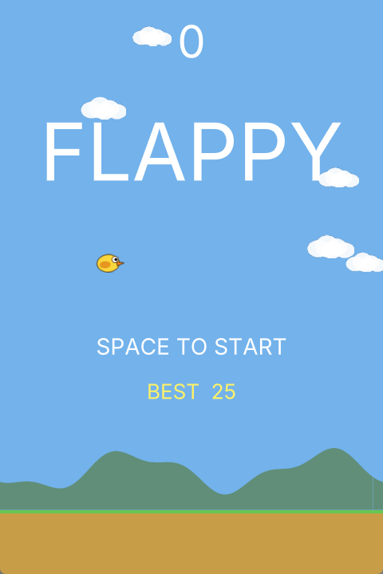
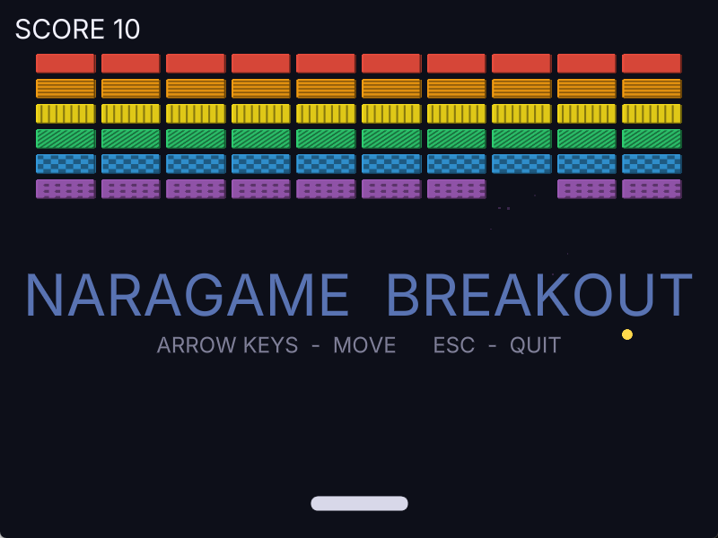
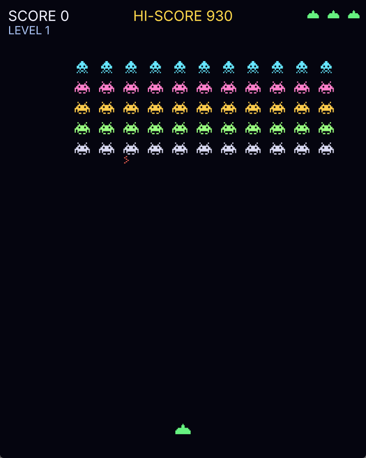
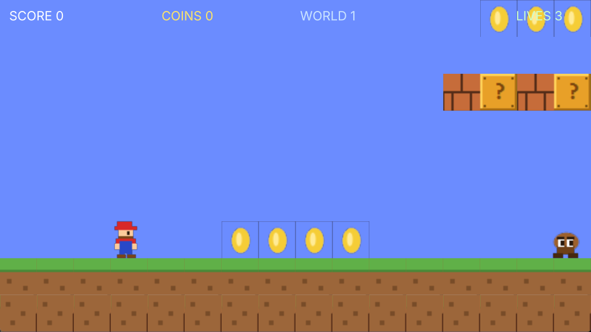
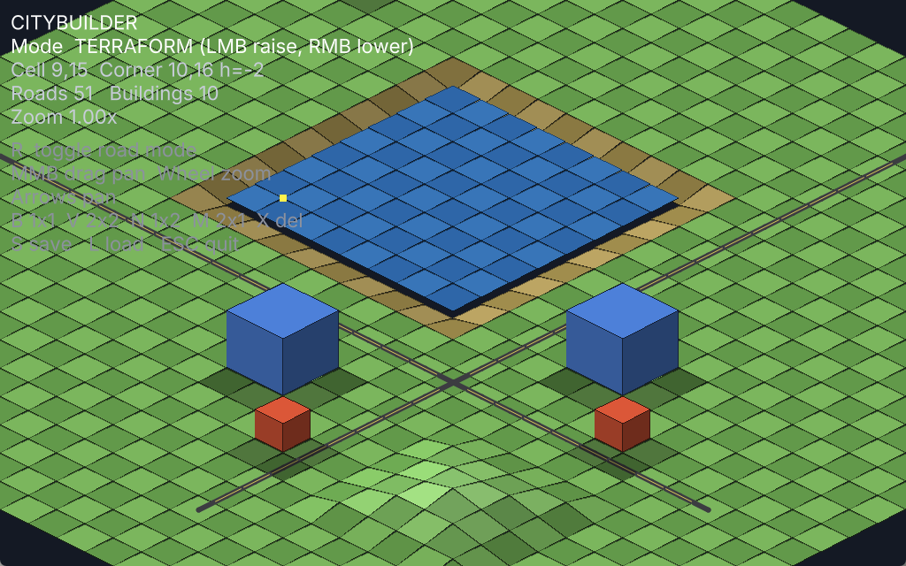

# NaraGame

크로스 플랫폼 2D/3D 게임 엔진. Windows · macOS · Android · iOS를 목표로 하며,
플랫폼별 네이티브 그래픽 API(Direct3D / Metal / Vulkan)를 자체 RHI 계층으로 추상화해 GPU 가속을 지원합니다.

주 개발 환경은 **Windows + Visual Studio 2022**이며, 현재 동작하는 백엔드는 **Direct3D 11**입니다.
나머지 플랫폼/백엔드는 동일한 인터페이스를 구현하는 스텁으로 골격만 잡혀 있습니다.

## 디렉토리 구조

```
NaraGame/
├─ CMakeLists.txt          # 루트 빌드 정의
├─ CMakePresets.json       # Visual Studio / Ninja 프리셋
├─ engine/                 # 엔진 (정적 라이브러리: NaraGame)
│  ├─ include/NaraGame/        # 공개 헤더 (#include "NaraGame/...")
│  │  ├─ core/             # Application, Log, Time, Platform 감지
│  │  ├─ math/             # 직접 구현한 수학 (Vec2/3/4, Mat4)
│  │  ├─ platform/         # Window 추상 인터페이스
│  │  ├─ input/            # Input, Key 코드
│  │  └─ renderer/rhi/     # RHIDevice 추상 인터페이스
│  └─ src/
│     ├─ core/             # 플랫폼 공통 구현
│     ├─ input/
│     ├─ platform/
│     │  ├─ windows/       # Win32 윈도우  (구현됨)
│     │  ├─ macos/         # Cocoa         (스텁)
│     │  ├─ ios/           # UIKit         (스텁)
│     │  └─ android/       # NativeActivity(스텁)
│     └─ renderer/rhi/
│        ├─ d3d11/         # Direct3D 11   (구현됨)
│        ├─ metal/         # Metal         (스텁)
│        └─ vulkan/        # Vulkan        (스텁)
├─ test/                   # 엔진을 사용하는 테스트 게임 (각각 실행 파일)
│  ├─ breakout/            # 벽돌깨기
│  ├─ space_invaders/      # 스페이스 인베이더
│  ├─ mario/               # 슈퍼마리오 클론
│  ├─ flappy/              # 플래피버드
│  └─ citybuilder/         # SC2K 스타일 아이소메트릭 도시 건설 (자체 README)
├─ tools/                  # MSDF 아틀라스 도구 (gitignored)
├─ scripts/                # 빌드 헬퍼 (아틀라스 굽기, 셰이더 컴파일)
├─ third_party/            # 외부 의존성 자리 (현재 비어 있음 — 직접 구현 원칙)
└─ docs/                   # 설계 문서 + 스크린샷
```

## 데모

엔진 위에서 돌아가는 다섯 개의 작은 완성 게임. 각각이 엔진의 한두 가지 기능을 키워내려고 만든 테스트베드입니다.

| | |
| :---: | :---: |
| **Flappy Bird**<br>중력/플랩, 파이프 스폰, AABB 충돌, 점수, 점진적 난이도, 메달 시스템, parallax 배경, 깃털 파티클, 하이스코어 영속화<br> | **Breakout**<br>벽돌 시트(단일 배치), 패들/공 아틀라스, 점수 텍스트, 파티클 디브리, 공용 물리(완전 반발 바디 + 정적 벽돌)<br> |
| **Space Invaders**<br>편대 이동/가장자리 낙하, 발사/폭탄, 점수·생명·레벨, 게임오버/재시작, 하이스코어 ConfigFile 영속화<br> | **Super Mario**<br>중력/가변 점프, 타일 AABB 충돌(축별), 코인/물음표 블록(밑에서 치면 코인 팝업), 굼바(밟기·피격), 씬 스택(타이틀↔게임↔일시정지), BGM<br> |
| **Citybuilder** *(자체 [README](test/citybuilder/README.md))*<br>32×32 아이소메트릭 그리드, 코너 높이 지형, 슬로프 캐스케이드, 자동 연결 도로, 4종 건물 + 드롭 그림자, 카메라(줌 어라운드 커서/팬), 평문 세이브/로드<br> | |

## 빌드 (Windows)

### Visual Studio에서 .sln 생성 후 디버깅
```powershell
cmake --preset windows-x64
cmake --build --preset windows-debug
# 또는 생성된 build/windows-x64/NaraGame.sln 을 Visual Studio로 열고 F5
```
시작 프로젝트는 `breakout`으로 설정되어 있습니다. F5를 누르면 창이 뜨고
D3D11로 화면이 클리어됩니다(애니메이션되는 배경색). 콘솔 창에는 로그가 출력됩니다.

### Visual Studio "폴더 열기"
이 폴더를 Visual Studio로 바로 열면 `CMakePresets.json`을 읽어 들입니다.
`windows-x64-ninja` 프리셋으로 증분 빌드가 빠릅니다.

### 렌더 백엔드 선택 (D3D11 / Vulkan)
기본 백엔드는 Direct3D 11입니다. **Vulkan SDK**가 설치돼 있으면 CMake가
자동 감지(`find_package(Vulkan)`)해 Vulkan 백엔드를 함께 빌드합니다. 실행 시
환경변수로 백엔드를 고릅니다:
```powershell
$env:NARAGAME_RHI = "vulkan"   # 이 게임을 Vulkan으로 실행 (기본: d3d11)
.\build\windows-x64\bin\Debug\breakout.exe
```
같은 게임 바이너리가 D3D11과 Vulkan 양쪽으로 동일하게 렌더됩니다.

## 핵심 설계 결정

| 항목 | 선택 | 이유 |
| --- | --- | --- |
| 언어 | C++20 | 크로스 플랫폼 + 네이티브 GPU 접근 |
| 빌드 | CMake + Presets | VS 통합, Xcode/NDK 생성 가능 |
| 렌더링 | 자체 RHI + 네이티브 백엔드 | 플랫폼별 최적 API와 디버깅(PIX/RenderDoc) |
| 기반 기능 | 직접 구현 | 수학/윈도잉/입력/로깅을 외부 의존성 없이 |

자세한 내용은 [docs/ARCHITECTURE.md](docs/ARCHITECTURE.md) 참고.
인-엔진 타일맵 에디터 사용법은 [docs/TILESET-EDITOR.md](docs/TILESET-EDITOR.md) 참고.
씬 에디터의 Lua 스크립팅 API는 [docs/LUA-SCRIPTING.md](docs/LUA-SCRIPTING.md) 참고.

## 현재 상태 / 다음 단계

- [x] 프로젝트 골격, CMake, 플랫폼/백엔드 디렉토리
- [x] Win32 창 + 입력 + D3D11 디바이스/스왑체인/클리어
- [x] 직접 구현한 수학 라이브러리
- [x] RHI 리소스(버퍼/텍스처/셰이더/파이프라인) + 알파 블렌딩
- [x] Renderer2D — 배치 처리되는 컬러/텍스처 쿼드 렌더러
- [x] PNG 로더 직접 구현 (DEFLATE/inflate 포함) + 텍스처 업로드
- [x] 스프라이트 시트(격자) + 아틀라스(이름) + TextureRegion UV 헬퍼
- [x] 비트맵 폰트 텍스트 렌더링 (BitmapFont + Renderer2D::DrawText, 스케일/틴트/중앙정렬)
- [x] Breakout 플레이 가능 — 시트 벽돌(단일 배치) + 아틀라스 공·패들 + 점수 텍스트 + AABB 충돌
- [x] Space Invaders 플레이 가능 — 편대 이동/가장자리 낙하 + 발사 + 폭탄 + 점수/생명/레벨 + 게임오버
- [x] 입력 엣지 트리거(IsKeyPressed/Released) + 스프라이트 좌우 반전
- [x] Camera2D(스크롤·타깃 추적·경계 클램프) + Tilemap(가시 영역 컬링 렌더)
- [x] Mario 플레이 가능 — 중력/가변 점프/축별 타일 AABB 충돌 + 코인 + 물음표 블록(밑에서 치면 코인 팝업 후 사용된 블록으로) + 굼바(밟기/피격) + 걷기·점프 애니메이션
- [x] 씬/상태 관리 (SceneManager 스택, 지연 전환) + 텍스트 레벨 파일 로더 — 타이틀↔게임↔일시정지, 파일 로드 2개 레벨
- [x] 비례 폭 폰트 (Font + BMFont .fnt 로더) — Renderer2D::DrawText, Mario 타이틀에 적용
- [x] 세이브/설정 파일 (ConfigFile, key=value) — Space Invaders 최고 점수 영속화
- [x] 사운드 — AudioDevice(XAudio2 백엔드) + 직접 구현한 WAV 디코더, SFX 믹싱 + 루프 BGM
- [x] **Vulkan 백엔드** — 두 번째 네이티브 RHI, 런타임 선택(`NARAGAME_RHI=vulkan`). 스왑체인·렌더패스·SPIR-V 셰이더·디스크립터·링버퍼로 세 게임 모두 D3D11과 동일하게 렌더 (검증 레이어 클린)
- [x] 공용 2D 물리 (PhysicsWorld) — 정적/키네마틱/동적 바디 + 중력 + **스윕 AABB 충돌(터널링 방지)** + 반발 계수 + 센서 + 접촉 보고
- [x] 세 게임 모두 공용 물리로 통일 — Breakout(공=반발 바디, 벽/벽돌=정적), Mario(솔리드 타일=정적, 플레이어·굼바=동적+중력/점프/타일 충돌), Space Invaders(총알·폭탄=동적, 외계인·플레이어=센서 → 겹침 접촉)
- [x] 파티클/이펙트 (ParticleSystem) — 풀 기반 버스트, 속도/수명/색·크기 보간(페이드아웃)+중력. 벽돌 파괴·외계인 폭발·굼바 밟기·코인 획득에 연결
- [x] **Flappy Bird** — 중력/플랩 + 스크롤 파이프 + 점진적 난이도 + 메달 시스템 + parallax 구름/산 + 깃털 파티클 + 하이스코어 영속화 + 타이틀 호버 애니메이션
- [x] **Citybuilder** — SC2K 스타일 아이소메트릭 도시 건설 (코너 높이 지형, 슬로프 캐스케이드, 자동 연결 도로, 건물 4종, 드롭 그림자, 카메라 줌·팬, 평문 세이브/로드). 자세한 내용은 [test/citybuilder/README.md](test/citybuilder/README.md)
- [x] 회전된 컬러/텍스처 쿼드 (Renderer2D::DrawQuad 각도 오버로드) — Flappy 새 기울기에 사용
- [x] **Per-texture 샘플러 필터** — TextureDesc::filter (Linear/Point), D3D11 백엔드가 두 샘플러를 BindTexture 시점에 선택
- [x] **MSDF 텍스트 렌더링** — Multi-channel Signed Distance Field 아틀라스 (msdf-atlas-gen + Inter TTF). Renderer2D의 두 번째 파이프라인이 median(rgb) + fwidth(uv)로 어떤 크기에서도 sharp한 글자를 만듭니다. 다섯 게임 모두 적용
- [ ] Metal 백엔드 (macOS/iOS)
- [ ] macOS · Android · iOS 윈도우 실제 구현
