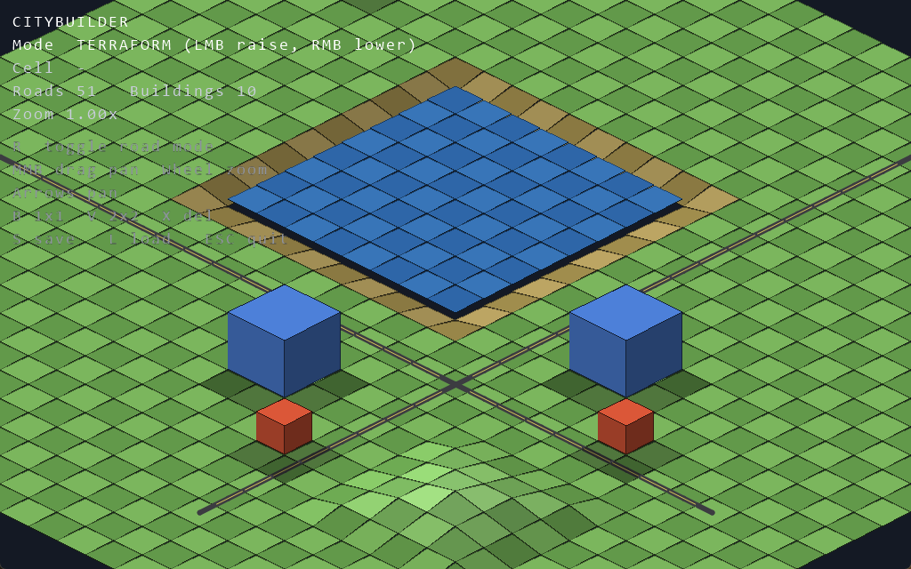
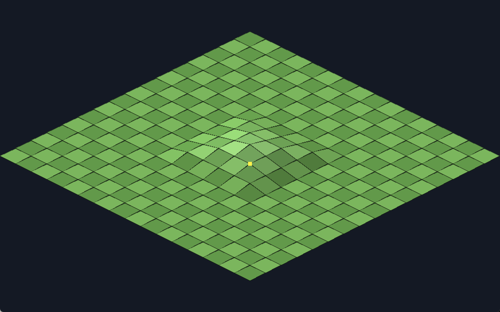
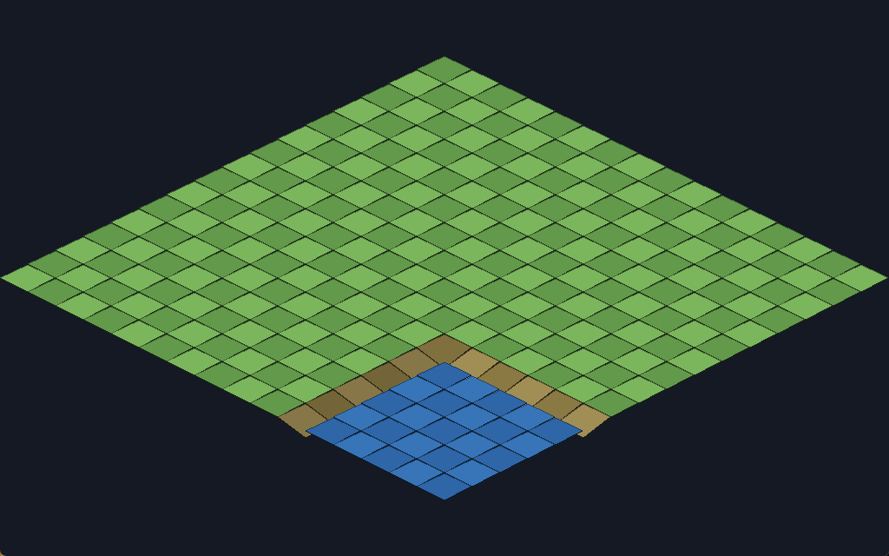
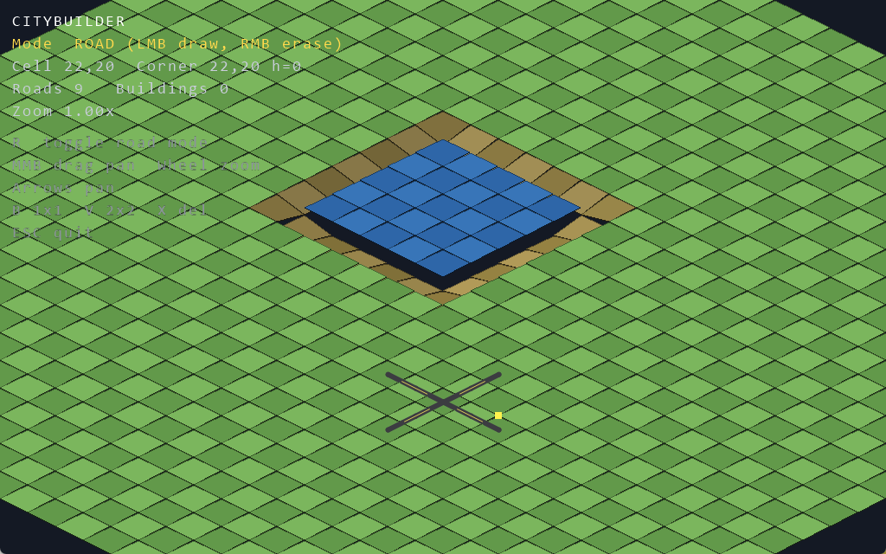
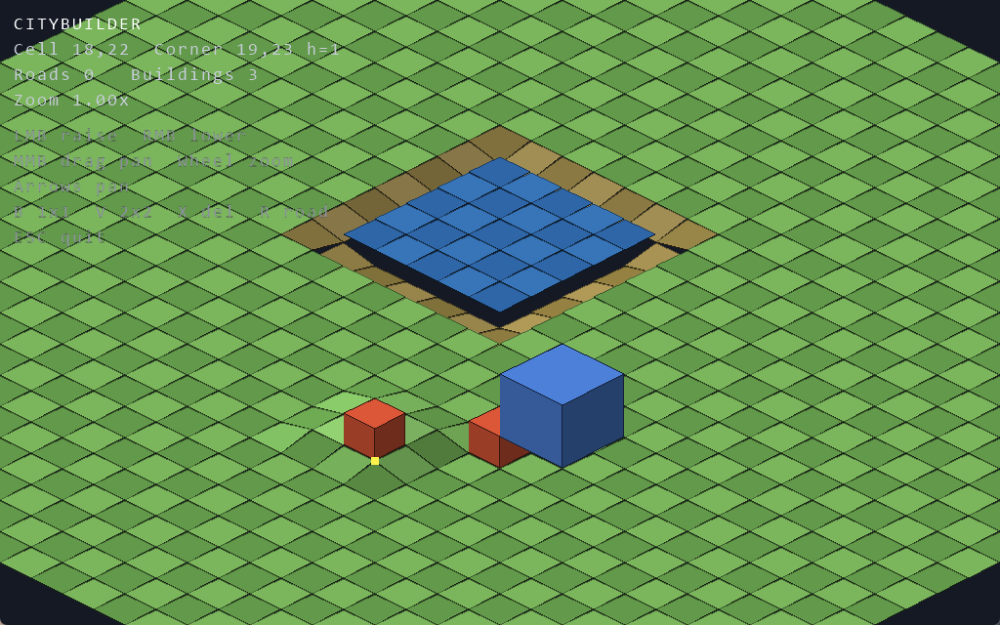
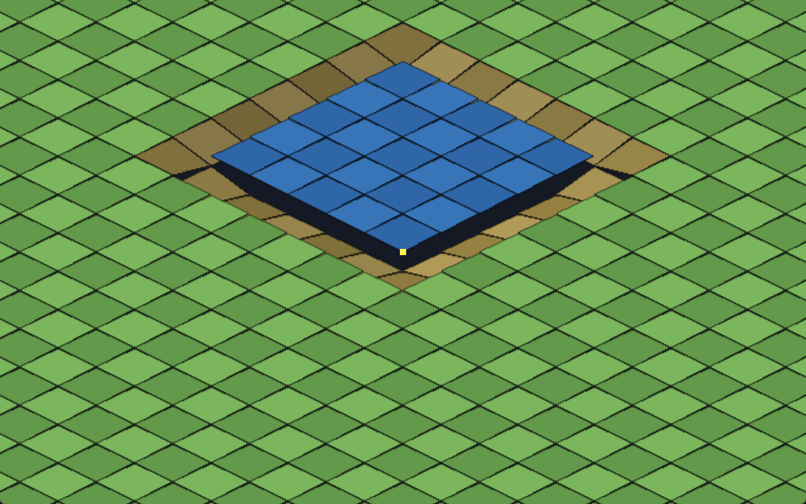
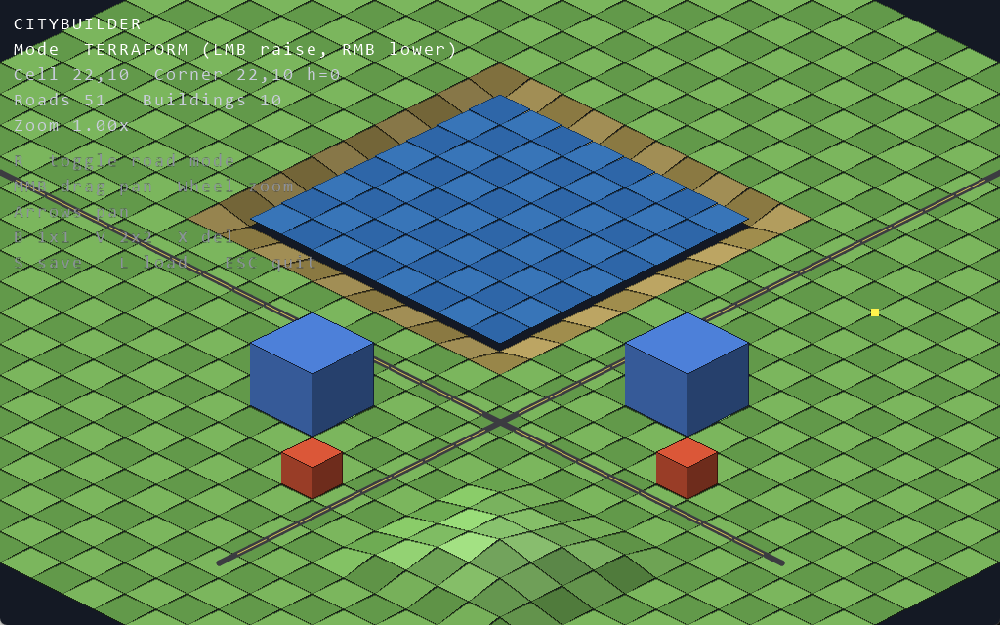
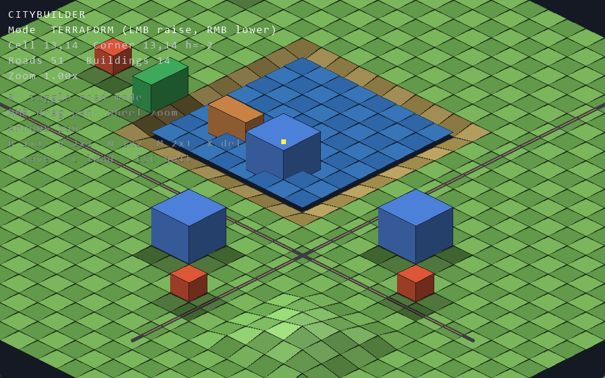
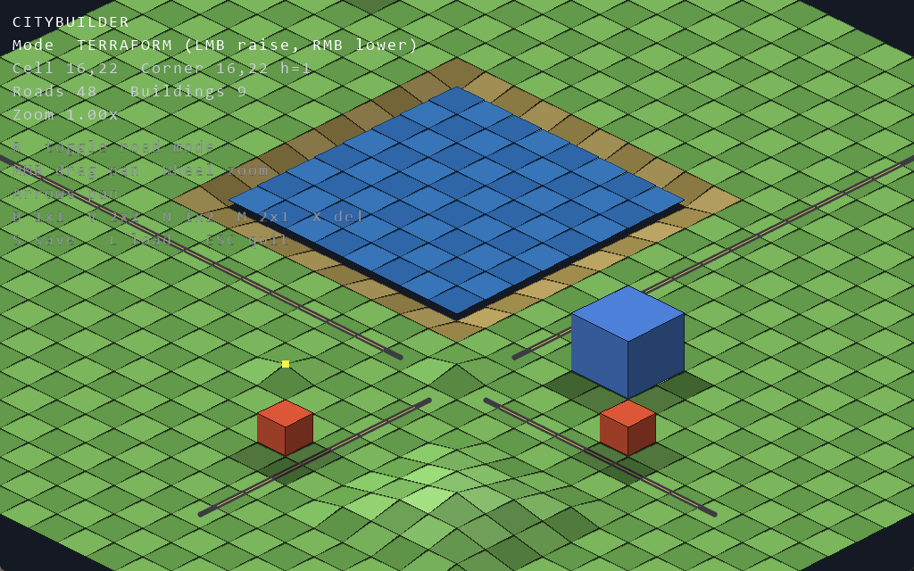

# Citybuilder

A SimCity-2000-style isometric city-builder prototype, built incrementally on
top of the NaraGame engine to grow and test its 2D rendering, input, and iso
terrain features.



## What's here

- 32×32 cell isometric grid with **corner-height terrain** (corners are shared
  between up to 4 cells, so editing one corner reshapes all of them)
- 16-variant slope atlas, picked live from a 4-bit "this corner > base elev"
  mask — no per-cell slope state stored
- 1-step **slope cascade** (8-connected BFS) so terrain edits ripple naturally
- Water / beach / land cells, derived from corner sign — no extra data
- **Auto-connecting roads** (16-variant cardinal-neighbour bitmask),
  drag-drawn with the mouse
- Four building footprints (1×1, 2×2, 1×2, 2×1) drawn as procedural **iso
  boxes** with three-face shading
- **Drop shadows** on cells SE of each building
- Camera with mouse-wheel **zoom-around-cursor** and middle-drag **pan**
- HUD overlay (mode, hover state, counters, controls)
- Plain-text **save / load** with a forward-compatible parser
- Procedural demo map ships as the opening world

## Run it

Tested on Windows 11 with Visual Studio 2022 + the bundled CMake.

```pwsh
& "C:\Program Files\Microsoft Visual Studio\2022\Community\Common7\IDE\CommonExtensions\Microsoft\CMake\CMake\bin\cmake.exe" `
    --preset windows-x64
& "C:\Program Files\Microsoft Visual Studio\2022\Community\Common7\IDE\CommonExtensions\Microsoft\CMake\CMake\bin\cmake.exe" `
    --build build\windows-x64 --config Debug --target citybuilder
.\build\windows-x64\bin\Debug\citybuilder.exe
```

## Controls

| Mode      | Input               | Action                                                          |
|-----------|---------------------|-----------------------------------------------------------------|
| Terraform | LMB                 | raise the corner nearest the cursor                             |
| Terraform | RMB                 | lower it (digs water once it goes below sea level)              |
| Road      | LMB-drag            | draw road on every flat-and-above-water cell the cursor touches |
| Road      | RMB-drag            | erase road                                                      |
| Any       | **R**               | toggle Terraform / Road mode                                    |
| Any       | **B / V / N / M**   | place 1×1 / 2×2 / 1×2 / 2×1 building at the hovered cell        |
| Any       | **X**               | remove any building under the cursor                            |
| Any       | Mouse wheel         | zoom in / out around the cursor                                 |
| Any       | MMB-drag            | pan the camera                                                  |
| Any       | Arrow keys          | pan the camera (alt)                                            |
| Any       | **S** / **L**       | save / load `./citybuilder.save`                                |
| Any       | ESC                 | quit                                                            |

## Architecture

```
engine/include/NaraGame/renderer/IsoTerrain.h
+--------------------------+
| IsoTerrain               |  data + math only -- no GPU, no game state
|   corner-height grid     |
|   1-step slope cascade   |
|   iso projection         |
|   PointInQuad helper     |
|   SlopeBrightness helper |
+--------------------------+

test/citybuilder/src/CitybuilderApp.cpp
+--------------------------+
| CitybuilderApp           |  ~600 lines of pure game code
|   DrawCell branches      |  ← water / beach / land tints
|   Roads (auto-connect)   |
|   Buildings (4 shapes)   |
|   Drop shadows           |
|   Camera2D + HUD pass    |
|   Save / Load            |
|   Procedural demo seed   |
+--------------------------+
```

Cell (0, 0) sits at world origin; the game adds the camera transform on top.
`IsoTerrain` itself is origin-agnostic, which made plugging Camera2D in a
two-line change.

One predicate decides every land question:

```cpp
bool CellIsBuildable(int x, int y) const {
    const IsoCellSlope s = m_terrain.CellSlope(x, y);
    return s.maxH == s.minH && s.minH >= 0;   // flat AND above water
}
```

`PlaceBuilding`, `TryPlaceRoad`, and `CleanupAfterTerraform` all share this
rule, so anything that can't be placed on a tile can't keep standing on it
either.

## Milestone journey

Every step below is a single commit (`git log` for the full message). The
screenshots are the automated verify frames captured the moment that step
landed, so they match the commit history exactly.

### Corner heights + slope atlas + Lambert shading

Pick one of 16 slope sprites per cell from a 4-bit corner mask; shade by the
slope's normal dotted with an upper-left light. Plateaus stay flat-bright,
sloped sides pop in or recede.



### Water + beach (cascade for free)

Drop `kMinHeight` below zero and the slope cascade fills in beach corners
automatically. `DrawCell` just branches on corner signs: all corners < 0 is
water rendered flat at sea level; mixed signs is beach (sandy slope).



### Auto-connecting roads

A `std::vector<bool>` per cell + a live 4-bit "which cardinal neighbour has
road" mask = 16 sprite variants picked per frame. Drawing one road silently
reshapes its neighbours' sprites because their mask just changed.



### Iso buildings — procedural 3-face boxes

Each building sprite is a top diamond plus the two camera-facing
parallelograms, generated by `System.Drawing.FillPolygon` with three baked
brightness levels (top base, SW face 70%, SE face 50%). Drop shadows tint
the cells SE of each footprint by reusing the slope sprite at 35% black.



### Camera + HUD

`Camera2D::ViewProjection()` drives the terrain pass; a second `Begin` /
`End` with the screen-space camera lays the HUD over the top, so it never
zooms or pans with the world. Mouse-wheel zoom keeps the world point under
the cursor stationary across zoom changes.



### Save / load + procedural demo map

`NaraSave 1` is plain text (grid header, camera, corner field, road bits,
buildings, `end`). The reader tolerates unknown tokens and any section
order, so v2 fields wouldn't break v1 saves. The opening screen loads a
packaged demo built by a PowerShell generator: each corner's height is
`max(hill lower bounds)` clamped down to `min(lake upper bounds)`, which is
1-Lipschitz in Chebyshev distance so the cascade rule is satisfied by
construction.



### Four footprints — one draw path

A shape table (`ShapeFor(w, h)` -> {sheet, sprite size, sprite-local south
corner}) turned the per-size if/else into one function. New shapes only need
new metadata + a sprite; the rest of `DrawBuilding` is uniform.



### Data consistency: cleanup after terraform

Terraforming a corner under existing roads or buildings now prunes them via
`CleanupAfterTerraform`. The single `CellIsBuildable` predicate keeps
placement and post-edit cleanup agreeing on what "buildable land" means.



## What graduated to the engine

The engine kept the bits that any iso game would want, the game kept its
own policy:

- `NaraGame::IsoTerrain` — corner-height grid, slope cascade, iso projection
  helpers, diagonal-iteration bounds for painter sort
- Free helpers `PointInTri`, `PointInQuad`, `SlopeBrightness`
- Mouse wheel via `Input::MouseWheelDelta()` (Windows path pumps
  `WM_MOUSEWHEEL`)
- Sub-frame edge-detection fix in `Input::IsKeyPressed` /
  `IsMousePressed` — a down + up that completes inside one `PollEvents`
  pump now still registers as a press, fixing the road-mode drag verify

Picking, water/beach branching, road/building data, shadow tinting, HUD
content, save format -- all game policy, left in this file.
